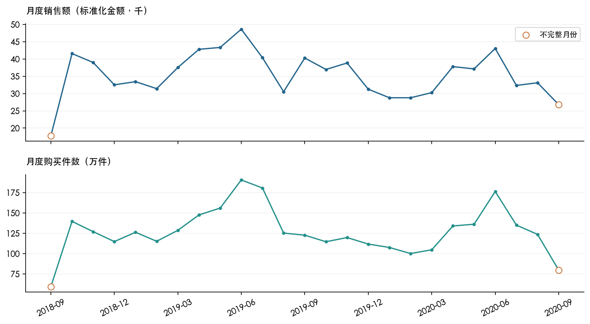

# H&M 销售、客户复购与日销量预测

**SQL业务分析 + Python时间序列回测的个人作品集项目。**

基于2018-09-20至2020-09-22的31,788,324条购买记录，研究销售变化、品类结构、复购行为，并比较6种日销量预测模型。分析仅代表竞赛数据样本，不代表H&M全部市场。

## 从这里开始

- [完整项目报告 PDF（12页）](reports/HM_完整项目报告.pdf)
- [完整项目报告 Markdown](reports/HM_完整项目报告.md)
- [English project report PDF](reports/HM_Project_Report_EN.pdf)
- [English project report Markdown](reports/HM_Project_Report_EN.md)
- [SQL逐表分析与限制](reports/sql_analysis_findings.md)
- [Python回测逐项分析](reports/python_analysis_findings.md)
- [结果文件索引与字段](reports/结果文件索引.md)



## 项目问题与主要发现

| 问题 | 结果 |
|---|---|
| 销售如何变化？ | 2020年1-8月销售额同比下降11.95%，件数下降13.02%。 |
| 哪些渠道与品类贡献主要销售？ | 渠道2贡献75.62%的销售额；上身、下身、全身服装合计约79.04%。 |
| 销售是否集中？ | 前约10%的有成交商品贡献61.67%销售额，前约20%贡献80.60%。 |
| 客户是否再次购买？ | 观察期多日购买客户占67.12%；完整30天观察窗口复购率28.13%。 |
| 后续购买贡献多大？ | 首次观察购买日之后的交易贡献84.41%件数、84.25%销售额。 |
| 复杂预测能否胜过简单基准？ | 验证选中的ARMA测试MAE劣于基准25.48%；SARIMA在该测试窗口MAE最低、WAPE10.26%。 |

最后一项保留了验证选模与测试表现不一致的结果。SARIMA是事后测试排名最优，不能改称验证集选中的最终模型，也不代表已证明其长期优势。

## 数据与指标

来源：[Kaggle H&M Personalized Fashion Recommendations](https://www.kaggle.com/competitions/h-and-m-personalized-fashion-recommendations/data)。请自行从原平台取得数据并遵守其访问、使用条件；本代码包不含原始客户、商品或交易CSV。

- 原始基础表：articles 105,542行，customers 1,371,980行。
- 交易表：31,788,324行，734个连续日期。
- 有交易客户1,362,281人；有成交商品104,547个。
- 一条交易行按一件购买商品统计，不能当作订单。
- price为标准化价格；销售额不标注人民币、美元等货币单位，不是利润。
- 首购是首次观察购买；跨日期再次购买定义为复购。
- 30/90/180天复购率分别使用完整对应后续窗口的客户。
- 渠道保留代码1和2；市场地域未核实。

## 目录

```text
code/                    SQL查询，按01-05排序
results/data_quality/    已保存的数据质量汇总
results/product_analysis/ 商品与品类结果
results/repurchase_analysis/ 客户复购及两张月度销售结果
forecasting/             Python模型、评估、依赖与日度汇总输入
forecasting/results/run_01/ 原实验输出
forecasting/results/run_02/ 本次复现及完整分析输出
reporting/               图表、报告、交付包生成代码
reports/                 完整报告、细分报告、图表、结果索引
```

## SQL分析复现

1. 在MySQL中建立 `hm_analysis`，将原平台三个CSV导入同名表 `articles`、`customers`、`transactions_train`。项目包含分析查询，不包含全自动导入器。保留customer_id和article_id的字符串标识，避免丢失前导零。
2. 使用支持CTE和窗口函数的MySQL环境。连接后运行 `USE hm_analysis;`，依次执行code目录中的01至05文件。
3. 04复购分析依赖临时表和 `@data_end`。在同一连接运行第0段及建表段，再运行后续查询；重连后要重新建立临时表并赋值。
4. 每段SELECT输出可分别导出CSV，已有24份汇总表在results目录，可直接阅读。完整结果名称和字段见结果索引。
5. 05日销量查询结果导出为 `forecasting/daily_sales.csv`，列名为 `date,units`。

重要：现有02和03查询的部分LAG增长率会跳过无记录月份。渠道1在2020年5月以及细分类的32处相关记录不可当作普通月环比；报告对此明确标注，未用这些异常环比支持结论。原SQL保留，未把缺月自动解释为真实零销量。

## Python回测复现

从项目目录进入forecasting，使用Python虚拟环境安装依赖：

```bash
cd forecasting
python3 -m venv .venv
source .venv/bin/activate
python -m pip install -r requirements.txt
python run_forecasting.py
```

已有正确环境时不必重新安装。在Spyder中打开 `run_forecasting.py` 运行整份文件也可以。只更新结果分析而不重新训练时运行 `analyze_forecasts.py`。

每次运行建立新的run编号目录，保存输入快照、验证与测试明细、指标、图表、中文报告和运行日志。项目中已有日度汇总，因此预测复现不要求重新导入3.2GB原始交易CSV。

模型为SeasonalNaive7、WeekdayMean4、ARMA(1,1)、ARIMA(1,1,1)、SARIMA(1,1,1)(0,1,1,7)、7天季节Holt-Winters。每次固定预测28天，5轮扩展窗口验证按平均MAE选模。测试为2020-08-26至2020-09-22。本次run_02是已查看过测试期的复现，不是新的独立盲测。

## 核验与边界

- 主要SQL总量交叉核对一致；24份汇总及其字段均保留。
- 36组回测、1,008条日预测全部完成。真实值与输入逐日一致，指标从明细独立重算一致。run_02与run_01的MAE逐项一致。
- 没有订单、实际货币、成本、利润、库存及可靠促销标签，因此不计算客单价、利润、售罄率或黑五效果。
- 最新客户群完整观察窗口不足、早期客户首次观察偏差、首尾不完整月份在报告中单独标注。
- 数据质量第4段，以及复购第5和12段的独立核验导出未保留；不将这些缺失文件视为已验证的直接证据。
- 本项目未证明业务建议的实际收益，也未将任何模型上线。

## 报告重建

`reporting/build_charts.py`使用pandas与Matplotlib生成报告图片。`reporting/build_report.py`额外依赖reportlab、pypdf，并使用macOS中文字体。报告以已编辑的Markdown为正文来源，不覆盖原文；设置`HM_CHART_LANGUAGE=en`生成英文图片，设置`HM_REPORT_LANGUAGE=en`生成英文PDF。SQL和Python注释已统一为英文，计算逻辑保持不变。主报告固定引用run_02，切换实验后需要同步检查正文及图表引用；它不是随意输入新数据即可自动解释的通用报告。

Python逐次运行报告由 `analyze_forecasts.py` 根据对应结果生成。`reporting/package_project.py`整理交付包和索引，不上传到任何网站。
