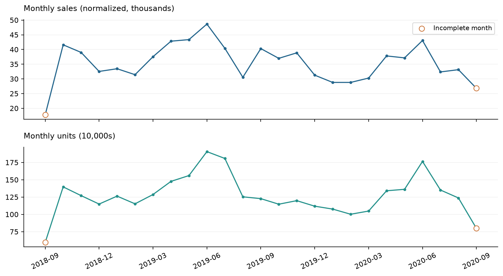
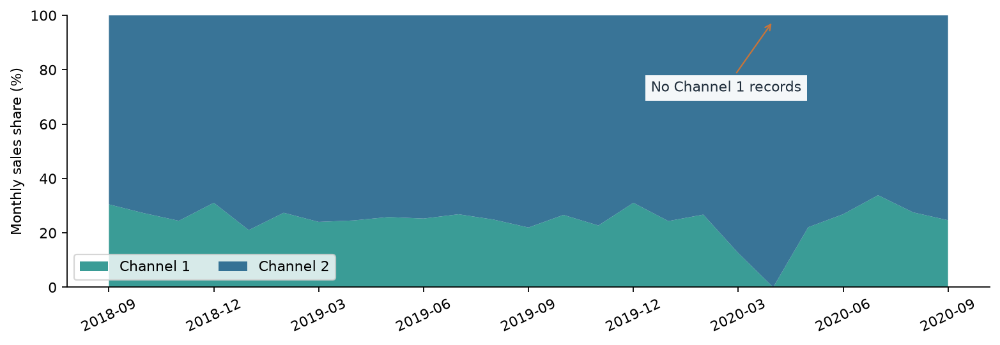
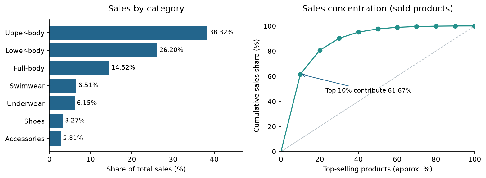
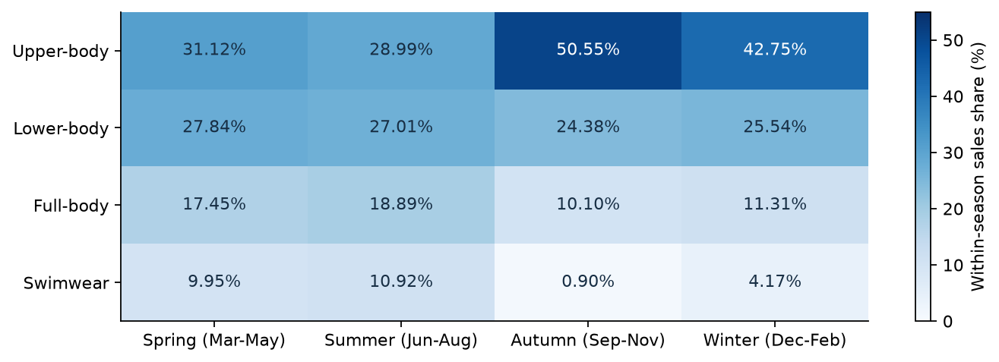
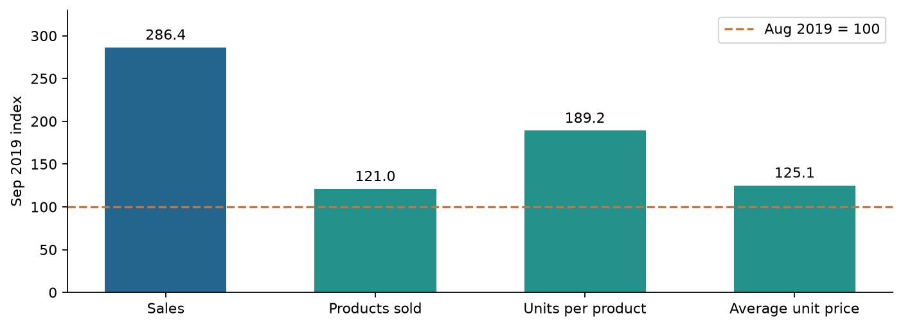
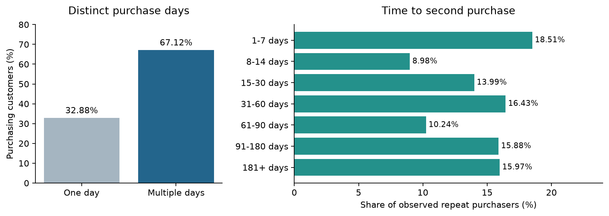
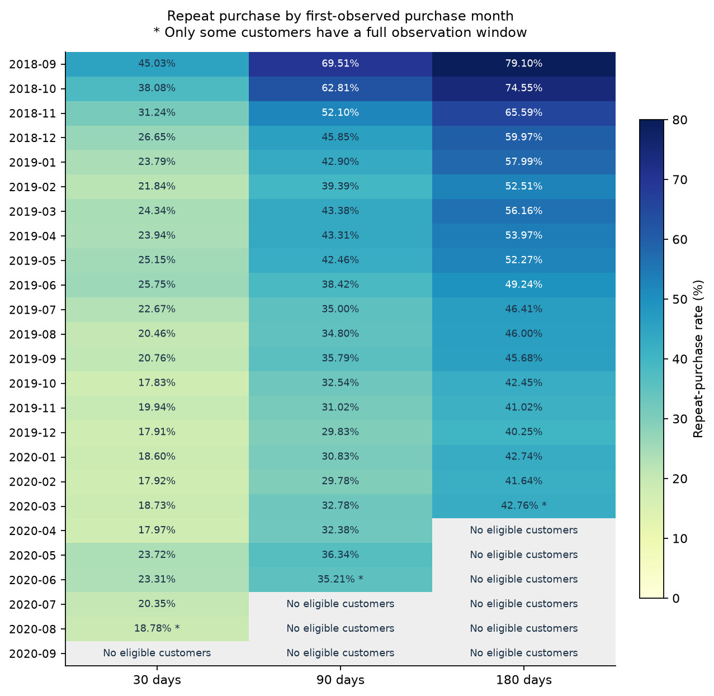
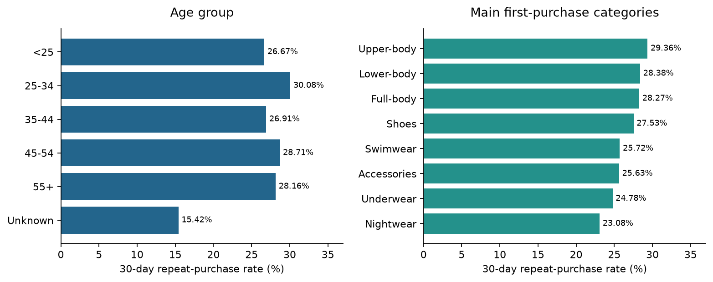
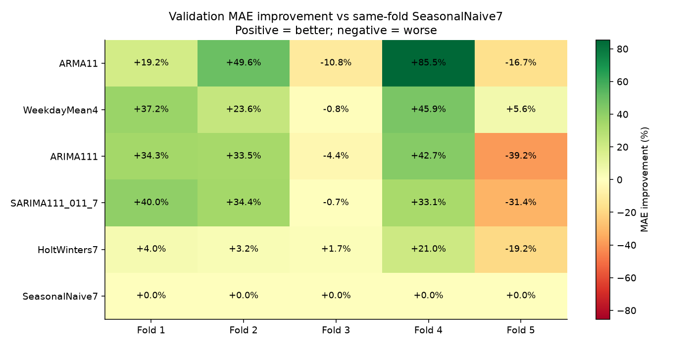
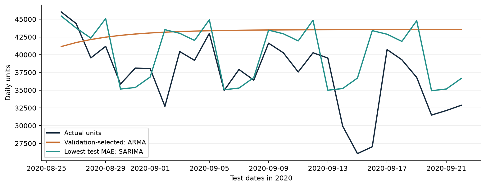

# H&M Sales, Repeat Purchase and Sales Forecasting

Complete project report | 2026-11-09

## H&M Sales, Repeat Purchase and Forecasting

SQL analysis and Python historical backtesting using a public transaction sample. Observation period: September 20, 2018 to September 22, 2020. Report prepared on November 9, 2026.

| Project scale | Result |
| --- | --- |
| Purchase records / consecutive days | 31,788,324 records / 734 days |
| Purchasing customers / sold products | 1,362,281 customers / 104,547 products |
| Tools | MySQL, Python, pandas, statsmodels, Matplotlib |
| Evaluation | Six models; five validation folds; a final 28-day holdout |

### Main findings

Sales: January-August 2020 sales value fell 11.95% year over year, while units fell 13.02%. Channel 2 contributed 75.62% of sales value over the observation period, with a pronounced change in channel mix during spring 2020.

Products: The three largest garment groups contributed approximately 79.04% of sales value. The top approximately 10% of sold products accounted for 61.67%, indicating substantial concentration.

Customers: The 30-day repeat-purchase rate was 28.13% among customers with a complete follow-up window. Purchases after the first observed purchase day contributed 84.41% of units and 84.25% of sales value.

Forecasting: Validation selected ARMA, but its holdout MAE was 25.48% worse than the simple baseline. SARIMA had the lowest holdout MAE and a WAPE of 10.26%. Different validation and test rankings indicate sensitivity to the evaluation period.

### Questions addressed

How did sales change? Which categories and products contributed most? Which customers purchased again, and how long did they take to return? Could fixed time-series specifications outperform simple daily-sales benchmarks?

Sales value is the sum of normalized prices and has no assigned currency unit. Findings apply only to this dataset. Business recommendations have not been deployed or experimentally validated.

## Data, Metric Definitions and Validation

Source: the Kaggle H&M Personalized Fashion Recommendations competition. The analysis uses product, customer and transaction tables; product images are not used. The geographic market represented by the sample has not been verified.

| Source table | Rows | Grain and purpose |
| --- | --- | --- |
| articles | 105,542 | One row per product identifier; category attributes |
| customers | 1,371,980 | One row per customer identifier; attributes such as age |
| transactions_train | 31,788,324 | Purchase records with date, customer, product, price and channel |

### Metric definitions

| Metric | Definition and boundary |
| --- | --- |
| Units | Transaction rows treated as purchase units, not orders; no order identifier is available. |
| Monthly customers | Distinct purchasing customers within a month; summing months or channels can double-count people. |
| Repeat purchase | A purchase on a different date after the first observed purchase day. |
| Windowed repeat rate | Customers purchasing again on days 1-30, 1-90 or 1-180, restricted to a complete corresponding follow-up window. |
| First-purchase attribution | The highest-value channel-by-category combination on the first observed purchase day; later purchases may cross categories or channels. |
| Age | A static customer-table attribute, not necessarily age at the time of purchase. |

### Completed checks

Dimension identifiers are non-null and unique, with no blank-string identifiers. Every transaction matches both a customer and a product. Transactions exist on all 734 dates. Age is missing for 15,861 customers (1.16%); observed ages range from 16 to 99, with no non-positive ages.

Key totals reconcile across 24 SQL exports. Monthly, channel, category and new/returning purchase summaries each total 31,788,324 units. Each of the three customer segmentations totals 1,338,029 eligible 30-day customers and 376,347 repeat purchasers.

Separate exports for date/price quality, temporary customer-table validation and original transaction totals were not found. Their direct results are not claimed as verified; available aggregate exports were cross-checked instead.

## Comparable-Period Sales Declined

Source: monthly_overall_performance.csv. Hollow markers identify incomplete endpoint months.

| Comparable period | Normalized sales value | Purchase units |
| --- | --- | --- |
| January-August 2019 | 308,191.107 | 11,706,632 |
| January-August 2020 | 271,363.710 | 10,181,863 |
| Year-over-year change | -11.95% | -13.02% |

Weighted average transaction price per unit rose approximately 1.24%. Under the identity sales value = units x average price per unit, lower units explain the main quantity change. A change in average price may reflect product mix rather than uniform price increases.

June 2019 recorded the highest monthly sales value, 48,648.418, and the highest unit volume, 1,906,202. Sales value increased 12.20% month over month, purchasing customers increased 12.39%, and spend per customer fell 0.16%. The increase was primarily associated with more purchasing customers.

October 2018 is compared with an incomplete September, and September 2020 is incomplete relative to August. Monthly totals also reflect different month lengths. These descriptive changes do not establish promotional or pandemic-related causation.

## Channel 2 Dominates, but the Mix Changed

Source: monthly_channel_performance.csv. Zero for channel 1 in April 2020 denotes no exported transaction row, not a verified closure.

| Metric | Channel 1 | Channel 2 |
| --- | --- | --- |
| Share of sales value, full observation period | 24.38% | 75.62% |
| Share of units, full observation period | 29.60% | 70.40% |
| Upper-body garments as a share of channel sales | 44.96% | 36.18% |
| Full-body garments as a share of channel sales | 9.74% | 16.07% |
| Swimwear as a share of channel sales | 3.72% | 7.41% |

Channel 2's share of sales value exceeds its unit share, implying a higher average transaction price per unit. Different category mixes may explain part of this difference; it does not establish higher profitability.

Channel 2's monthly sales share rose from 73.29% in February 2020 to 87.42% in March and 100% in April, before returning to 77.94% in May. Transaction coverage and business context should be checked before interpreting this shift.

Important limitation: channel 1's reported May 2020 growth of 115.14% compares with March because LAG skips the missing April row. It is not treated as ordinary month-over-month growth. Channel codes are not relabeled as online or offline.

## Core Categories and Concentrated Product Sales

Sources: category_sales_structure.csv and product_sales_concentration.csv. Concentration includes only products with observed sales.

Upper-body, lower-body and full-body garments contribute 38.32%, 26.20% and 14.52% of sales value, respectively, or approximately 79.04% together. The top approximately 10% of sold products, 10,455 products, contribute 61.67%; the top approximately 20% contribute 80.60%.

Source: seasonal_category_sales_structure.csv. Seasons use calendar-month definitions and pool observations across years.

Upper-body garments have a larger share in autumn and winter; swimwear and full-body garments have larger shares in spring and summer. Monitor core categories by season and channel and investigate availability of leading products. Inventory, margin and product-age data are needed before recommending specific stock increases or discontinuing long-tail items.

Seasonal coverage is unequal, so shares describe mix rather than establishing seasonal demand levels. group_sale repeats across product-type rows and must not be summed directly. The 995 catalog products without observed sales are not automatically classified as slow-moving stock.

## Decomposing Category Growth

Source: monthly_product_type_performance.csv. Every metric is indexed to August 2019 = 100.

Sweater sales value increased 186.44% in September 2019. The number of products with sales rose 21.03%, units per sold product rose 89.17%, and average transaction price per unit rose 25.11%. These factors multiply; their growth rates must not simply be added.

| Category within the top 10% of sold products | Products | Share of top-product sales |
| --- | --- | --- |
| Upper-body garments | 4,007 | 35.97% |
| Lower-body garments | 2,676 | 30.65% |
| Full-body garments | 1,828 | 14.49% |
| Swimwear | 746 | 8.51% |

Lower-body garments and swimwear have larger shares within top-product sales than within total sales. Leading products in these categories are useful monitoring candidates. This measure is not the percentage of each category's products entering the top group.

Monthly mix also changes: among complete months, swimwear accounts for 15.17% of sales value in June 2019 and 0.51% in November. Both sales value and share should be shown because a falling share can also result from growth elsewhere.

Products with sales are not the same as listed products, and units per product is not sell-through. The product-type table contains 32 LAG comparisons across missing months; these are not ordinary consecutive-month growth rates.

## Repeat Purchasing and Observation Windows

Sources: customer_repurchase_overview.csv and second_purchase_interval_distribution.csv. The interval chart includes observed repeat purchasers only.

| Metric | Result | Denominator or scope |
| --- | --- | --- |
| 30-day repeat rate | 28.13% | 1,338,029 customers with complete 30-day follow-up |
| 90-day repeat rate | 47.07% | 1,291,147 customers with complete 90-day follow-up |
| 180-day repeat rate | 59.95% | 1,189,917 customers with complete 180-day follow-up |
| Second-purchase interval | Median 44 days; mean 90.59 days | 914,308 observed repeat purchasers |

Among observed repeat purchasers, 41.48% made their second purchase within 30 days and 57.91% within 60 days. This denominator differs from the overall 30-day repeat rate. Customers without an observed repeat purchase are excluded from interval statistics, so the median is not a return time for all customers.

Transactions after the first observed purchase day total 26,832,675 units, or 84.41% of all units and 84.25% of sales value. Subsequent purchasing is an important source of sales, but these shares are not the incremental impact of retention campaigns.

A customer's first observed purchase day is classified as new and later days as existing; these are transaction groups, not disjoint customer groups. One-day purchasers are not automatically churned. Rates with different follow-up windows have different denominators and cannot be subtracted to estimate incremental repeat rates for one fixed cohort.

## Repeat-Purchase Rates Differ Across Cohorts

Source: monthly_cohort_repurchase_rates.csv. Gray cells indicate no customers with complete follow-up, not a zero repeat rate.

Early cohorts have higher repeat rates, but may include customers who purchased before observation began. The pattern does not establish deteriorating acquisition quality. During 2019, monthly-cohort 30-day rates range from 17.83% to 25.75%; the rate rises from 17.97% in April 2020 to 23.72% in May.

Only 16,260 of August 2020's 22,974 first-observed customers have complete 30-day follow-up, so its 18.78% rate applies only to this eligible subset. March 2020 at 180 days and June 2020 at 90 days also have partial eligibility. Missing rates in recent cohorts should not be plotted as zero.

## Evaluate Rates Alongside Segment Size

Sources: age_group_30d_repurchase.csv and first_category_30d_repurchase.csv. The category chart shows selected major categories; all results are retained.

| First-purchase channel | Eligible customers | 30-day repeat customers | Repeat rate |
| --- | --- | --- | --- |
| Channel 1 | 463,219 | 138,825 | 29.97% |
| Channel 2 | 874,810 | 237,522 | 27.15% |

Channel 1's rate is 2.82 percentage points higher, but channel 2 has more repeat purchasers. The 25-34 age group has a rate of 30.08%, 3.41 percentage points above the under-25 group. Its 115,942 repeat purchasers are also the largest count among age groups.

Upper-body garments have 571,765 eligible first-purchase customers and a 29.36% repeat rate, making this a substantial segment for further research. Interior textile reaches 50%, but with only two eligible customers; ranking by percentage alone would be misleading.

Differences may reflect cohort month, category, age and channel composition; no causal effect has been identified. Attribution uses the highest-value first-day channel-by-category combination, while subsequent purchases may occur elsewhere. Unknown age is a missing-information group, not an actual age band.

## Historical Backtesting of Six Fixed Models

The target is daily purchase units in the sample. Each forecast predicts the next 28 days at a fixed origin, without updating on actual values inside that horizon. Five expanding-window validation folds select a model using mean MAE before evaluation on a fixed holdout.

| Model | Fixed specification |
| --- | --- |
| SeasonalNaive7 | Repeat the final training week |
| WeekdayMean4 | Average each weekday over the last four weeks |
| ARMA11 | ARMA(1,1), with a constant |
| ARIMA111 | ARIMA(1,1,1), without a trend constant |
| SARIMA111_011_7 | SARIMA(1,1,1)(0,1,1,7) |
| HoltWinters7 | Additive seven-day seasonality and a damped additive trend |

Validation runs from April 8 to August 25, 2020 in five consecutive, non-overlapping 28-day windows. Final training ends on August 25; the holdout is August 26 to September 22. All models use the same nonnegative forecast constraint.

MAE improvement relative to the seasonal-naive baseline within each validation fold. Positive is better; negative is worse.

ARMA has the lowest mean validation MAE, 10,768.91 units, but beats the baseline in only three of five folds. Its improvement in fold 4 is 85.46%. Average rankings hide variation across evaluation windows.

The MA component refers to past forecast errors, not a simple average of sales. These are fixed specifications, not optimized model families. Repeating an already viewed holdout is a reproduction, not a new independent blind test.

## The Validation Winner Did Not Win on Holdout

| Model | MAE, units | WAPE | MAE improvement vs baseline |
| --- | --- | --- | --- |
| SARIMA | 3,823.29 | 10.26% | +25.66% |
| Holt-Winters | 3,875.46 | 10.40% | +24.65% |
| ARIMA | 4,254.99 | 11.42% | +17.27% |
| SeasonalNaive7 | 5,143.29 | 13.80% | Baseline |
| WeekdayMean4 | 6,414.73 | 17.21% | -24.72% |
| ARMA, validation-selected | 6,453.82 | 17.32% | -25.48% |

Source: run_02/test_actual_vs_forecast.csv. Actual holdout sales total 1,043,390 units, averaging 37,263.93 per day.

ARMA overpredicts on 26 of 28 days and overpredicts total volume by 15.87%. Its later forecasts approach 43,500 units per day and fail to follow lower actual daily sales. SARIMA has the lowest holdout MAE, while Holt-Winters has the lowest RMSE; their small difference should not be overstated.

The seasonal-naive model underpredicts total volume by only 1.61%, but its WAPE is 13.80%. Positive and negative daily errors cancel in aggregate totals, so a close total does not establish accurate daily forecasts.

WAPE is total absolute daily error divided by actual total volume; it is not a direct accuracy score. MASE7 uses a training-period denominator, so a value below one does not prove superiority over the holdout baseline. SARIMA must not be retrospectively described as the validation-selected model.

## Recommendations, Limitations and Reproduction

| Recommendation | Evidence | How to validate next |
| --- | --- | --- |
| Monitor core products and seasonal categories | Top 10% of sold products contribute 61.67% of sales value | Add inventory, availability, launch dates and margins to assess stockouts and long-tail value |
| Investigate segmented post-purchase outreach | 30-day repeat rate is 28.13%; segment rates differ | Use randomized controls to compare repeat purchasing and incremental profit |
| Investigate channel coverage changes | Channel 1 has no April 2020 transaction row | Verify data coverage and business context before explaining the shift |
| Retain simple forecast benchmarks | Validation-selected ARMA underperforms on holdout | Evaluate tuning on new periods or nested temporal validation; monitor directional bias |

### Limitations that accompany the conclusions

Order identifiers, currency amounts, profit, inventory, promotion labels and verified market scope are unavailable. Endpoint months are incomplete. First purchase means first observed purchase, and some customers lack full follow-up. Segment comparisons are not causal. Channel 1's May 2020 growth and 32 product-type LAG comparisons are not ordinary consecutive-month changes.

### Deliverables and reproduction

SQL files 01-05 cover quality checks, monthly sales, products, repeat purchasing and daily-unit extraction. Import the three source tables first. Temporary repeat-purchase tables and @data_end must be used in the same MySQL connection. Exports are in results/.

forecasting/run_forecasting.py is the full Python entry point. backtest.py implements modeling and evaluation; analyze_forecasts.py produces diagnostics. run_02 retains 36 score rows, 1,008 forecasts, charts, logs, input snapshots and environment versions. Reproduced MAEs match run_01 entry by entry.

Detailed evidence is in sql_analysis_findings.md and python_analysis_findings.md. The README provides navigation and reproduction instructions. The code package excludes the 3.2 GB raw transaction CSV and local virtual environment. The code package is published in this repository.

### Data source and attribution

Kaggle: H&M Personalized Fashion Recommendations
https://www.kaggle.com/competitions/h-and-m-personalized-fashion-recommendations/data
This is a personal analytical project, not an official H&M statement. Obtain the source data from the competition page and follow its access and usage conditions.
