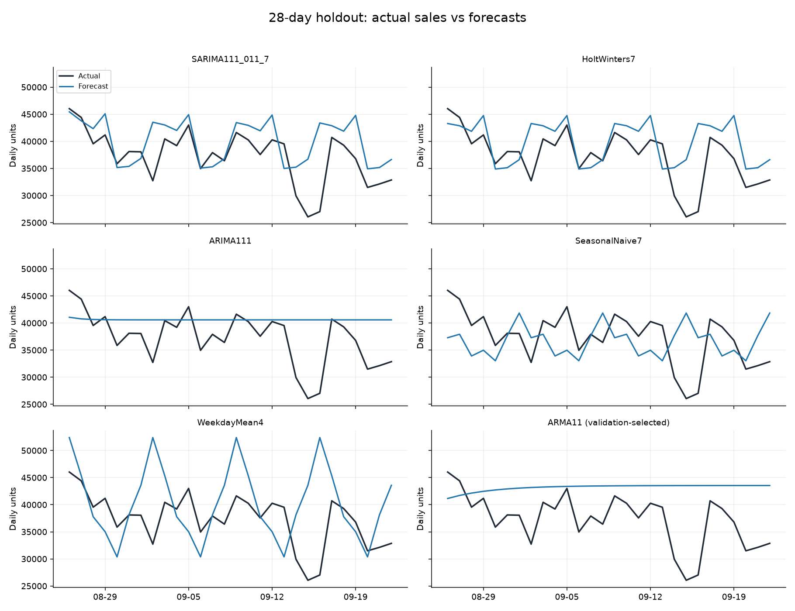
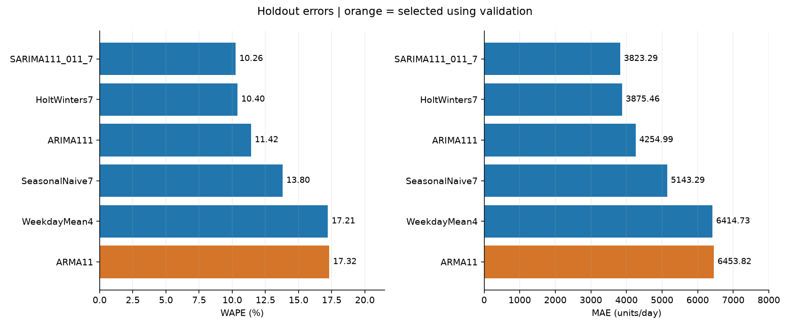
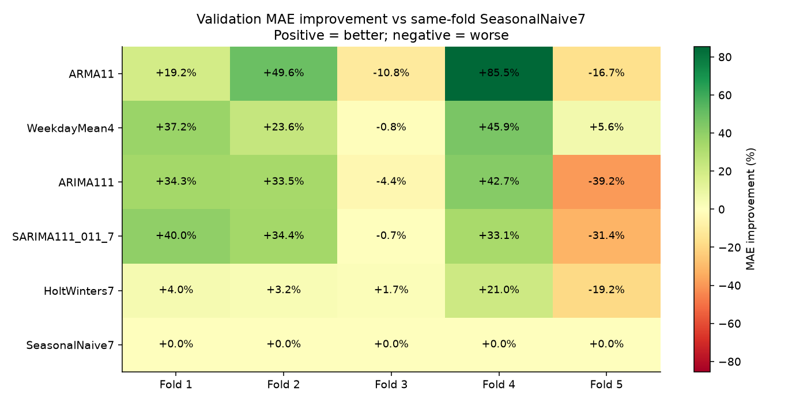
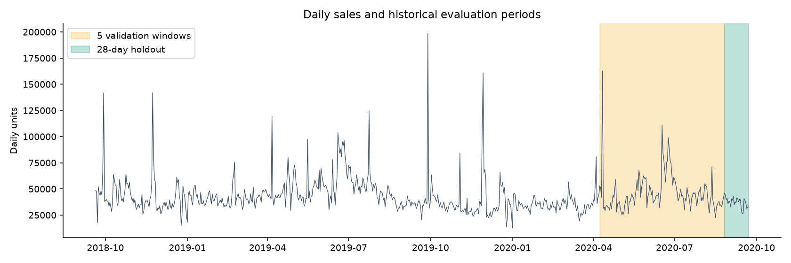

# H&M Python 日销量预测：回测分析

本报告使用 `run_02` 的重新运行结果。仅预测数据集内每日购买件数，不代表H&M全部市场销量，也不是2026年预测。价格、库存、促销和国家信息未作为模型输入。

## 1. 任务与实验设计

- 输入：734天，31,788,324件，2018-09-20至2020-09-22。
- 每次在预测起点一次性预测之后28天，不用预测区间的真实值更新模型。
- 5个连续、不重叠的验证窗口；每轮训练集向后扩展。
- 根据验证集平均MAE选模型，选定后才在程序中计算测试指标。
- 最终训练截止2020-08-25；固定测试期2020-08-26至2020-09-22。
- 本次是对已看过测试结果的同一实验进行复现，不是新的独立盲测。没有因测试排名而更改阶数或重新选模型。

| fold | train_end | forecast_start | forecast_end |
| --- | --- | --- | --- |
| 1 | 2020-04-07 | 2020-04-08 | 2020-05-05 |
| 2 | 2020-05-05 | 2020-05-06 | 2020-06-02 |
| 3 | 2020-06-02 | 2020-06-03 | 2020-06-30 |
| 4 | 2020-06-30 | 2020-07-01 | 2020-07-28 |
| 5 | 2020-07-28 | 2020-07-29 | 2020-08-25 |

## 2. 六个模型分别做什么

| 模型 | 本次设置与含义 |
|---|---|
| SeasonalNaive7 | 重复训练末尾7天销量；简单周周期基准 |
| WeekdayMean4 | 最近4周同一星期几的平均销量 |
| ARMA11 | ARMA(1,1)，以一期销量和一期误差描述相关性；含常数；没有显式季节项 |
| ARIMA111 | ARIMA(1,1,1)，先对销量作一阶差分，再描述差分的相关性；无趋势常数 |
| SARIMA111_011_7 | SARIMA(1,1,1)(0,1,1,7)，在普通差分外加入7天季节差分与季节误差项 |
| HoltWinters7 | 加性水平、阻尼趋势和7天加性季节项的指数平滑 |

ARMA中的MA是过去误差项的加权关系，不是WeekdayMean4的销量平均。所有模型使用同一训练范围，统一把负预测截为0，保留小数计算误差。这里比较的是六个固定设置，不代表整个模型家族的最优性能。

## 3. 先看验证集：为何选中ARMA11

| model | completed_folds | mean_MAE | sd_MAE | mean_WAPE_pct | folds_beating_baseline |
| --- | --- | --- | --- | --- | --- |
| ARMA11 | 5 | 10,768.91 | 5,637.27 | 22.83 | 3 |
| WeekdayMean4 | 5 | 12,772.19 | 4,303.44 | 27.39 | 4 |
| ARIMA111 | 5 | 13,509.56 | 3,832.16 | 29.19 | 3 |
| SARIMA111_011_7 | 5 | 13,632.07 | 4,900.95 | 29.51 | 3 |
| HoltWinters7 | 5 | 16,372.04 | 5,528.78 | 35.86 | 4 |
| SeasonalNaive7 | 5 | 17,683.24 | 8,355.04 | 38.80 | 0 |

`mean_MAE`为5轮MAE的简单平均，是选模依据。`mean_WAPE_pct`为5轮WAPE的简单平均，不是将全部验证日期合并后计算的WAPE。`sd_MAE`表示轮次之间的误差波动，轮次难度、销量规模不同也会影响它。

ARMA11的验证平均MAE为10,768.91件，在5轮中有3轮优于同轮季节性朴素基准。平均表现最好不表示每一轮都最好，应结合逐轮比较图查看优势是否集中在个别窗口。

## 4. 最终28天：与真实销量直接比较

测试期实际总销量为1,043,390件，日均37,263.93件。

| model | MAE | RMSE | WAPE_pct | MASE7 | bias_pct | selected_on_validation | MAE_improvement_vs_baseline_pct |
| --- | --- | --- | --- | --- | --- | --- | --- |
| SARIMA111_011_7 | 3,823.29 | 5,231.48 | 10.26 | 0.33 | 7.76 | False | 25.66 |
| HoltWinters7 | 3,875.46 | 5,198.43 | 10.40 | 0.33 | 7.11 | False | 24.65 |
| ARIMA111 | 4,254.99 | 5,819.52 | 11.42 | 0.36 | 8.97 | False | 17.27 |
| SeasonalNaive7 | 5,143.29 | 6,092.54 | 13.80 | 0.44 | -1.61 | False | 0.00 |
| WeekdayMean4 | 6,414.73 | 8,748.20 | 17.21 | 0.55 | 8.35 | False | -24.72 |
| ARMA11 | 6,453.82 | 7,836.16 | 17.32 | 0.55 | 15.87 | True | -25.48 |

- 测试期MAE最小的是SARIMA111_011_7：MAE 3,823.29件，WAPE 10.26%，相对基准MAE改善25.66%。这是事后测试排名，不能替代验证集选模记录。
- 预先按验证集选中的ARMA11：MAE 6,453.82件，WAPE 17.32%，相对基准MAE改善-25.48%（负数表示更差）。
- 简单基准SeasonalNaive7：MAE 5,143.29件，WAPE 13.80%。复杂模型需要与同一测试期的基准比较。
- RMSE最低的是HoltWinters7（5,198.43件）。MAE和RMSE排名可能不同，因为RMSE更重视较大的日误差。
- 验证与测试排名发生变化，说明本次选模效果没有稳定延续；本实验没有证明具体业务原因，也不能据此认定某模型永远更好。

实际总销量与预测总量对照如下。真实值在模型行中重复，是为了对照，不能跨模型相加：

| model | actual_units | predicted_units | absolute_error_units | bias_pct |
| --- | --- | --- | --- | --- |
| SARIMA111_011_7 | 1,043,390.00 | 1,124,405.73 | 107,052.07 | 7.76 |
| HoltWinters7 | 1,043,390.00 | 1,117,535.78 | 108,512.95 | 7.11 |
| ARIMA111 | 1,043,390.00 | 1,136,932.28 | 119,139.74 | 8.97 |
| SeasonalNaive7 | 1,043,390.00 | 1,026,576.00 | 144,012.00 | -1.61 |
| WeekdayMean4 | 1,043,390.00 | 1,130,485.00 | 179,612.50 | 8.35 |
| ARMA11 | 1,043,390.00 | 1,208,946.32 | 180,706.96 | 15.87 |

这里还说明“预测总量接近实际”与“每天都预测准确”不同。季节性朴素法的总量bias绝对值为1.61%，但日误差的WAPE为13.80%，不同日期的高估、低估会在总量中抵消。

### 从图上看六个模型

- ARMA11：本次最后7个预测值集中在43,531—43,538件，接近水平线；没有显式周季节项。在本测试期实际销量较低的日子容易高估，图上可见这种差异，但不能据此推断其他时期也一定如此。
- ARIMA111：最后7个预测值集中在40,577—40,577件，同样缺少明显周内波动。固定起点的多步预测没有持续接收新真实值，变平不意味着程序停止工作。
- SARIMA和Holt-Winters：预测具有7天起伏，但仍未准确跟随所有日度低点。最低MAE与最低RMSE落在不同模型，评价指标的侧重点有影响；没有进行显著性检验，不能把微小差异描述为确定优势。
- SeasonalNaive7：机械重复最近一周，透明、便于比较，是需要保留的基准，不因简单就自动劣于复杂模型。
- WeekdayMean4：在本测试期周三的WAPE最高，达到42.17%。可检查最近4周该星期的水平是否适合测试期；仅4个测试观测，暂不推断长期规律。

## 5. 偏差方向、每日大误差与星期结构

ARMA11测试期bias为15.87%。本代码以“预测−实际”为误差，正值表示总体高估、负值表示总体低估。WAPE先对每日误差取绝对值，不能被不同日期的正负偏差抵消。

该模型28天中有26天高估、2天低估。绝对误差最大的日期是2020-09-15：实际26,053件，预测43,528.35件，绝对误差17,475.35件。

`test_actual_vs_forecast.csv`及同名图片直接列出真实值与预测值。`test_largest_errors.csv`保留每个模型误差最大的3天，可用于查找共同遗漏的销量波动；不能仅凭异常日期给它贴促销标签。

`test_weekday_errors.csv`中weekday=0表示周一，6表示周日。每个星期几在28天内只有4个观测，结果仅作排查线索，不能作为长期星期效应的充分证据。销量还受到库存等未观察因素影响，不等于无约束需求。

## 6. 指标如何解释

| 指标 | 定义和用途 |
|---|---|
| MAE | 每日绝对误差平均值，单位是件；越低越好 |
| MSE | 每日误差平方的平均值，单位件²，数值大不等于模型一定差 |
| RMSE | MSE开平方，单位件，对较大误差更敏感 |
| WAPE_pct | 每日绝对误差之和÷实际总销量×100；10表示10%，不是直接的准确率 |
| MASE7 | 测试MAE÷训练期销量与7天前之差的平均绝对值；小于1不保证击败同一测试期的季节性朴素法 |
| bias_pct | 预测总量减实际总量，再除以实际总量×100；反映方向，可发生正负抵消 |
| MAE_improvement_vs_baseline_pct | (1−模型MAE÷同一测试窗口基准MAE)×100；负值表示劣于基准 |

分母为0时相应比率无定义，保存为空值。不能把WAPE机械转换成“准确率=100%−WAPE”，也不能设一个适用于所有商品、规模和预测期限的统一合格线。

## 7. 可以写进项目报告的结论

1. 在相同数据与28天预测期限下，比较了两种简单基准、ARMA、ARIMA、SARIMA及Holt-Winters六种设置。
2. 采用5轮扩展窗口验证，以平均MAE选择ARMA11，并保留固定测试窗口检验其表现。
3. 验证最优模型未稳定保持测试优势，应保留这一结果，而不是事后替换选模记录。
4. 测试期SARIMA111_011_7取得最低MAE，但只有一个最终窗口，不能推断长期优势或生产环境效果。
5. 若继续调参，当前测试期已经被查看，后续结果应标为探索性；新的可靠比较需要更多未用于决策的时期或嵌套时间验证。
6. 本分析未引入促销、库存、价格、商品级特征，不把预测错误归因于某个未经核实的活动。没有库存与缺货成本，不能直接估计备货利润。

## 8. 运行核验与复现

- 6模型×6轮×28天，共1008条预测；每个模型使用同一轮的相同日期。
- 所有真实值与输入日销量逐日核对一致；MAE、RMSE、WAPE、bias由预测明细独立重算并与回测表核对一致。
- 本次记录的警告/错误共0条，详见model_issues.csv（空表保留列名）。
- 与run_01匹配36组模型/轮次结果，MAE最大绝对差为0.0000000000件。
- 输入日销量快照、原始CSV的SHA-256和依赖版本已保存，便于追溯。

## 9. 图表

